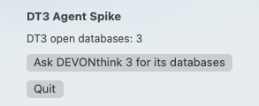
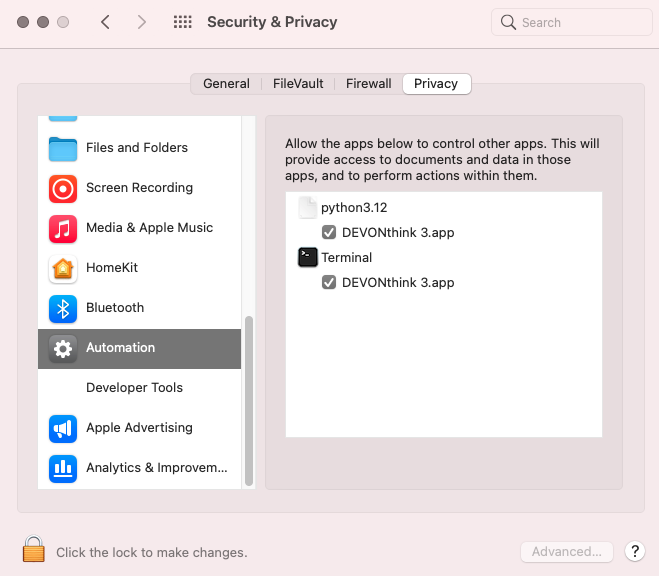
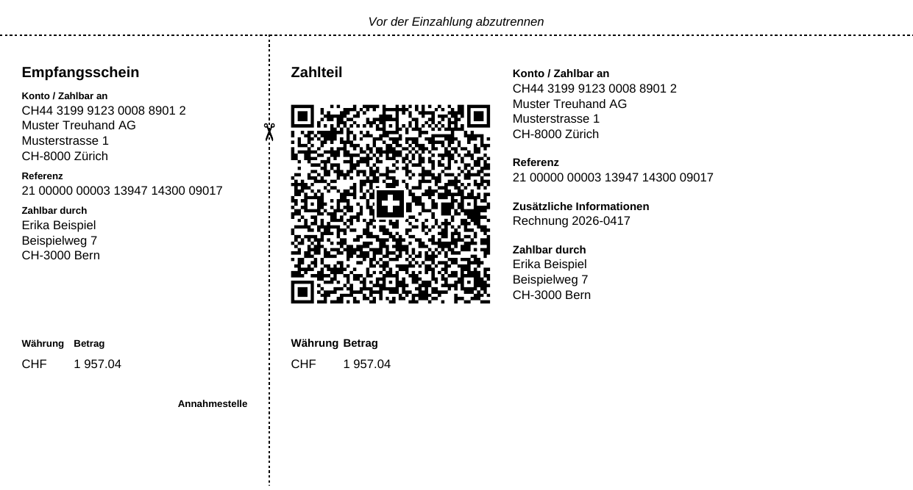
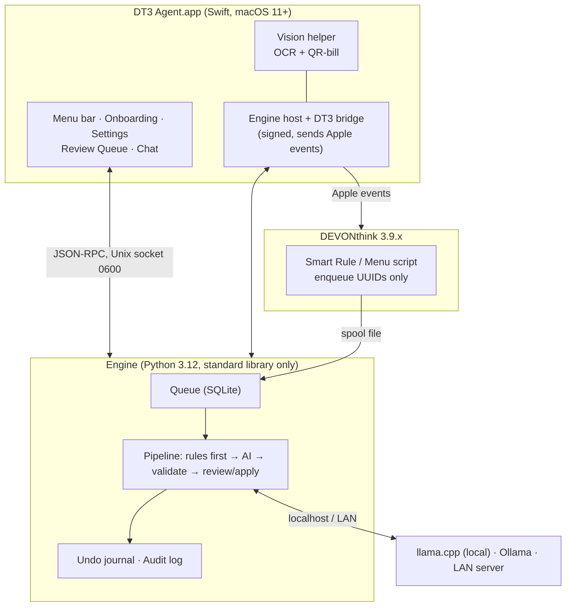

# DT3 Agent — private, offline AI for DEVONthink 3

**Local agentic AI for DEVONthink 3 users on macOS.** Names, tags and files your documents, reads Swiss QR-bills, finds duplicates, flags deadlines and lets you chat with your archive — **100 % on your Mac, no cloud, no telemetry, no token limits.**

> **Status: release candidate (Phase 8 of 8), not published yet.** All features are built and tested on a 2014 MacBook Pro with macOS 11 and DEVONthink 3.9.17 ([floor reports](docs/floor/)). The final release test is running; there is **no public download yet**. Watch or star the repo to follow progress — contributors welcome (see below).

*Working name. DT3 Agent is an independent open-source project and is **not affiliated with, endorsed by or sponsored by DEVONtechnologies**. "DEVONthink" is a trademark of its owner and is used here only to describe compatibility.*

---

## Why

DEVONthink 4 ships with built-in AI; many people stay on **DEVONthink 3** — and many documents (contracts, tax letters, medical and legal files) must never leave the Mac. DT3 Agent adds AI to DT3 **without sending anything anywhere**, and it runs even on a **2014 MacBook Pro with macOS 11 Big Sur**.

## What it does

| Block | Features |
|---|---|
| **A — Inbox** | Text-layer check + OCR · language · document type · document date/time · sender/receiver · standard file name `YYYYMMDDHHMMSS_sender_receiver_subject` · tags from your vocabulary · filing into allowed groups · 3-line summary · duplicate handling (replicate, copy, link note — always your decision) |
| **B — Swiss** | Swiss QR-bill decoding (IBAN/QR-IBAN, references validated) · UID/MWST numbers · retention classes · stated deadlines → reminder proposals · urgent letters (Betreibung, court, tax office) |
| **C — Knowledge** | Semantic index · chat with your documents, answers always with `x-devonthink-item://` sources · related documents · entities · translation de ↔ fr ↔ it ↔ en |
| **D — Schedules** | Nightly incremental run · weekly digest · hygiene and tag-hygiene reports |
| **E — Operations** | Health status · **dry-run by default** · **undo for everything** · opt-in per database/group · power mode · optional AI server in your LAN |

**Safety rules built in:** never deletes anything in DEVONthink · rules first, AI second · AI output is validated before use · low confidence goes to a Review Queue instead of being applied.

## Proven on the floor machine (Phase 0)

Measured on a **MacBook Pro 15" Mid 2014, macOS 11.7.11, Intel i7, DEVONthink 3.9.17** — full report: [`docs/spike/phase0-report.md`](docs/spike/phase0-report.md).

| Building block | Result |
|---|---|
| Local AI (Qwen3-1.7B, llama.cpp, CPU only) | **20/20** structured answers, **~20 s** per 1-page document, 1.9 GB memory |
| OCR (Apple Vision) | German 99.7 %, French 96.6 %, Italian 100 %, English 100 % character accuracy |
| Swiss QR-bill | Payload decoded **byte-exact** in < 1 s |
| DEVONthink 3 scripting | Rename, tags, custom metadata, replicate, duplicate, move, item links, import, duplicate detection |
| Background engine | macOS LaunchAgent, auto-restart, private Unix socket (`0600`) |
| Menu-bar app | Universal (Intel + Apple Silicon), runs on macOS 11 |
| Distribution without Apple Developer ID | Self-signed certificate keeps the DEVONthink permission across updates |

### First screenshots (Phase 0 test builds)

| Menu-bar test app talking to DEVONthink 3 | macOS Automation permission | Synthetic Swiss QR-bill test fixture |
|---|---|---|
|  |  |  |

*These are throwaway spike builds that prove the platform works — not the final UI.*

## Architecture

Design decisions are recorded as ADRs in [`docs/adr/`](docs/adr/).

## Supported (target)

| Environment | Status |
|---|---|
| macOS 11 Big Sur, Intel, 8 GB | Supported (≤ 3B model, slower) |
| macOS 11–26 Intel | Supported; LAN AI server recommended for speed |
| macOS 12+ Apple Silicon | Supported, best experience |
| DEVONthink 3.9.x | Supported (verified on 3.9.17) |
| DEVONthink 4 | Not supported (has built-in AI) |
| Windows / Linux | Not planned — macOS only |

## Roadmap

| Phase | Content | Status |
|---|---|---|
| 0 | Floor spike on the 2014 MacBook Pro | ✅ done |
| 1 | Spec + plan ([`docs/SPEC.md`](docs/SPEC.md), [`fsd/plan.md`](fsd/plan.md)) | ✅ approved |
| 2 | Walking skeleton: trigger → queue → AI → tag → undo | ✅ done |
| 3 | Block A — inbox pipeline, naming, review, duplicates | ✅ approved |
| 4 | Block B — Swiss QR-bill, UID, deadlines, urgent letters | ✅ approved |
| 5 | Menu-bar app, onboarding, settings, 4 languages | ✅ approved |
| 6 | Block C — index, chat with sources | ✅ approved |
| 7 | Blocks D + E — schedules, health, power mode | ✅ approved |
| 8 | Release — signed DMG, docs de/fr/it/en | ⏳ in progress, not published |

## Get involved

This is a public, Apache-2.0 project and **cooperation is very welcome**:

- 🧪 **Testers** with DEVONthink 3 on older Macs (macOS 11/12, Intel) — real-world floor testing
- 🐍 **Python** developers (stdlib-only engine, rules, tests)
- 🍎 **Swift / SwiftUI** developers (macOS 11 API level, accessibility)
- 🇨🇭 **Swiss domain knowledge** — QR-bill, UID/MWST, fiduciary workflows
- 🌍 **Translators** — fr-CH, it-CH, en (de-CH is the default)
- 💡 Ideas and feedback — open an [issue](../../issues) or a discussion

Start with [`CONTRIBUTING.md`](CONTRIBUTING.md). Security issues: see [`SECURITY.md`](SECURITY.md).

## Privacy

User guide: [Deutsch](docs/guide/de.md) · [Français](docs/guide/fr.md) · [Italiano](docs/guide/it.md) · [English](docs/guide/en.md).

All processing happens on your Mac (or on an AI server **you** run in your own network). No telemetry, no cloud calls, no update check; the only download is the AI model, after your consent. Logs contain no document content by default. Details: [`PRIVACY.md`](PRIVACY.md).

## Support

- **Individuals:** community support via GitHub Issues and Discussions.
- **Swiss SMEs and fiduciaries:** professional support plans by [modular.codes](https://modular.codes) — see [`SUPPORT.md`](SUPPORT.md).

## License

[Apache License 2.0](LICENSE). Model weights are never bundled; they are downloaded only after your consent, with their own license shown.
